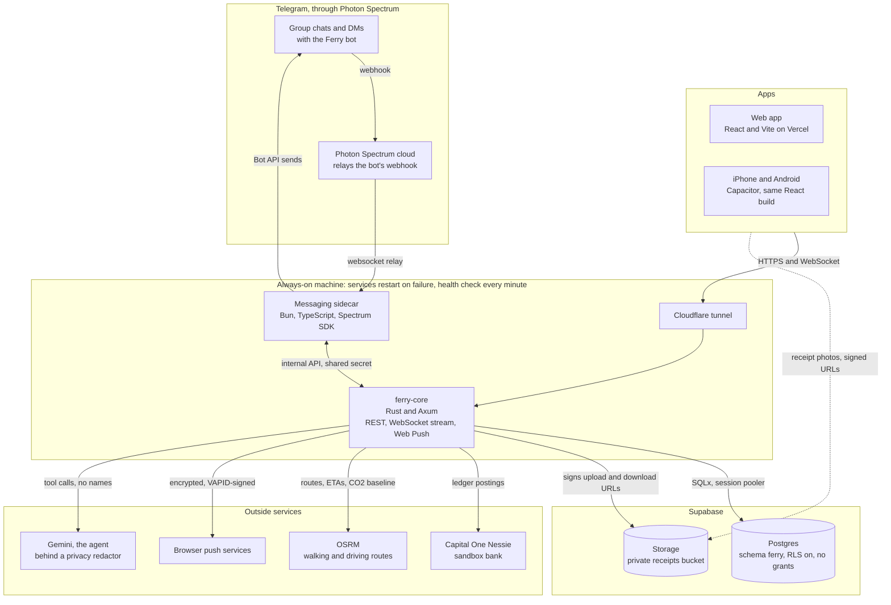
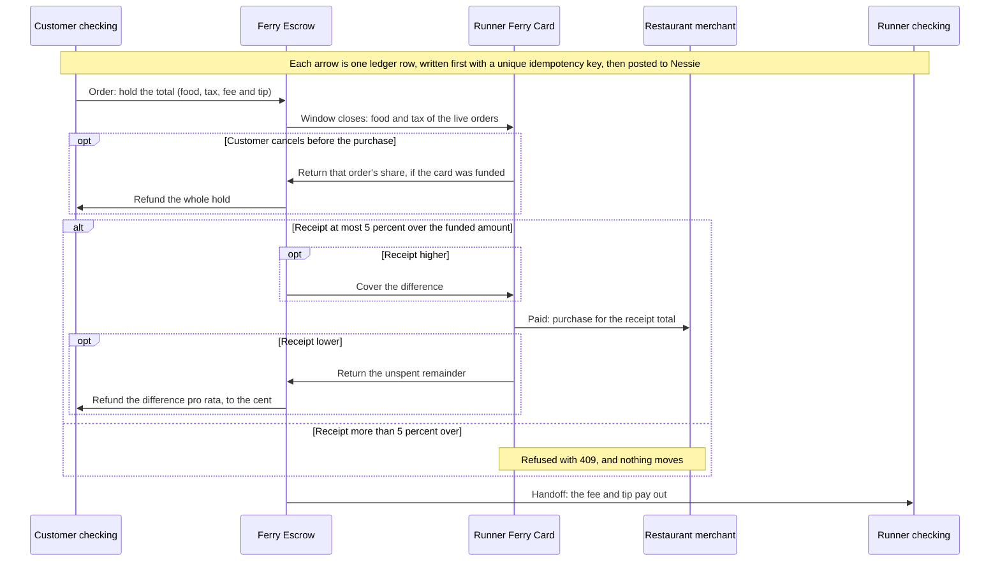

# Ferry

Ferry turns trips students already make into food pickups for their friends. Someone in a group chat says "heading to Cosmic Cantina at 6", and Ferry opens a short order window for the group, collects the orders, pays the restaurant without the runner fronting or holding anyone's money, shows the walk on a map, and settles everyone up through Capital One's Nessie sandbox. Ferry is an agent in the group's Telegram chat, [@Ferrygo_bot](https://t.me/Ferrygo_bot), with a web app and iPhone and Android apps beside it. Every delivery is walked, so every order shows the CO2 a car delivery would have emitted. Built at HackNC 2026 at UNC Chapel Hill.

## Try it

| What | Where |
|---|---|
| Web app | **https://ferrygo.tech**. Sign in as a demo persona. |
| Telegram | [@Ferrygo_bot](https://t.me/Ferrygo_bot). The bot handles Telegram sign-in, and it is the agent that opens runs and takes orders in groups. |
| Android | [ferry.apk](https://www.ferrygo.tech/downloads/ferry.apk), from the website. The iPhone app is built from Xcode for now; there is no App Store listing. |
| Live API | https://dimensions-comedy-moderate-stat.trycloudflare.com, a Cloudflare quick tunnel to the server, so the address can change. |

Demo personas, all four in the circle "Hinton James 4th floor":

- **Jordan** (`judge`): judges start here, and order from Maya's ferry.
- **Maya** (`maya`): the runner. She closes the window, pays and walks the food over.
- **Dana** (`dana`): a friend on the floor, who sends the meet-again invite.
- **Leo** (`leo`): runs cookie trips from Insomnia.

**The hosted website and the Android APK run in mock mode.** The whole demo plays on your device against the contract's fixtures, through a mock service worker, so nothing you do there reaches the live server or Nessie. To use the live backend, run the web app locally against it:

```sh
cd frontend && npm ci
VITE_API_MODE=live VITE_API_BASE_URL=https://<live host> VITE_WS_URL=wss://<live host> npm run dev
```

The live server runs in demo mode, so the same four personas sign in there too.

## How a Ferry run works

1. **A trip.** Maya posts "heading to Cosmic Cantina at 6, anyone want anything?" in the group. The agent spots the trip, opens a run with a 10-minute order window, and replies with a button to the run's page. In the app, **I'm going somewhere** posts the trip to a community the runner picks, by default **UNC Chapel Hill**, the public community every account is in. Anyone signed in can see and order on a trip there, and opening it notifies nobody: people find it by browsing open trips or through a request. A friends' circle, if picked, stays private, and its other members get a notification.
2. **Request a Ferry.** No trip yet? A customer requests food from a restaurant. It matches an open trip to that restaurant, in one of the customer's communities, whose walk back takes at most 4 extra minutes with their drop-off added; the customer gets a notification to order on it. When none fits, the runner of a trip to a restaurant within 300 m gets asked to pick it up too, with a link that opens a new Ferry to the requested restaurant. No money moves until the customer orders.
3. **Orders.** Friends order in the app: the menu, a tip, and a drop-off spot on the map. In Telegram they can reply "chicken burrito no beans" and confirm the total the bot quotes. Each order holds its whole total from the customer's checking in Ferry's Escrow. A short balance is refused, and so is an order after the window closes.
4. **Close.** Maya closes the window. Escrow funds her Ferry Card with exactly the food and tax of the orders still live: a prepaid card for this run only, never her own money.
5. **Purchase.** At the counter Maya pays with the Ferry Card, snaps the receipt and taps **Paid** with the receipt total. The photo goes straight to a private storage bucket through a signed upload URL, and each customer sees it on their order through a signed link.
6. **The walk.** Maya taps **Picked up**. Her phone posts its location every few seconds, and her customers watch her bubble walk the real walking route with an ETA and the location's age ("4 min away, seen 20 s ago"). In demo mode the server walks Maya along the route itself. Asking the bot "how long until my food gets here?" gets the same answer: Maya's distance, the ETA and how old her location is.
7. **Handoff.** The customer taps **Got it**, or Maya enters the customer's 4-digit handoff code. Maya's fee and tip pay out, and the order settles.
8. **CO2.** The customer's Delivered notification states the saving, such as "+389 g CO2 saved vs a car delivery (EPA estimate)" on the live server for Cosmic Cantina to Fetzer Gym: the driving distance a car delivery would have covered, at about 400 g of CO2 per mile. Impact adds it up for you, your circle and the campus.
9. **Meet again.** Later, Dana pings the circle to meet up, with a place and a time: **Meet again** in the app, or the bot ("anyone want to go to Cosmic at 7?", "ask the people from last time if they want Sup Dogs at 8 tomorrow"). Each of the others gets "Dana wants to go to Cosmic Cantina at 7:00 PM. You in?" in Telegram with **I'm in** and **Can't make it** buttons, and an invite in the app (and a Web Push if they turned push on). Each answer is relayed to Dana. Whoever accepts gets a Telegram link to the group: the group's own invite link where the bot is an admin, else a link that adds Ferry to a group. Meet-ups aren't available in the public UNC Chapel Hill community.

## Architecture



| Part | What it does | Live? |
|---|---|---|
| Web app | React, Vite and MapLibre, on Vercel at ferrygo.tech. Types and mocks are generated from the contract. | Live, in mock mode |
| iPhone and Android | The same React build in Capacitor. A desktop browser runs the web app, and Telegram sign-in shows a QR code there. | Android APK on the website, mock mode; iPhone through Xcode |
| ferry-core | One Rust service (Axum, Tokio, SQLx): the REST API in [contract/openapi.yaml](contract/openapi.yaml), the WebSocket stream in [contract/events.md](contract/events.md) (six event types, single-use tickets), Web Push, payments and the ledger, routing and ETAs, and the demo seed, reset and runner simulator. | Live |
| Supabase | Postgres: 31 tables and 2 views in schema `ferry`, from SQLx migrations run at startup. Storage holds the receipt photos. Supabase Auth, the Data API and Realtime are not used: ferry-core issues its own tokens and runs its own WebSocket. | Live |
| Messaging sidecar | A thin bridge on Photon's Spectrum SDK, which is TypeScript only: it forwards Telegram events to ferry-core and sends what ferry-core asks, with link and callback buttons. No business logic. | Live, with Telegram sign-in |
| Nessie | Capital One's sandbox bank: one checking account per user, Ferry's Escrow, one Ferry Card per runner, and one merchant per restaurant. A mock mode with the same interface can stand in during a Nessie outage. | Live sandbox |
| OSRM | The public FOSSGIS server: walking routes for the map and ETAs, driving distance for the CO2 baseline. Cached, paced to one request a second, and it falls back to the straight line × 1.3. | Live |
| Gemini | The agent's tool-calling brain: trip detection, ordering by text, ETAs and meet-again. Code computes every total, ETA and permission; the model only picks tools and phrases replies. | Live (#22) |
| Hosting | No cloud deploy. ferry-core, the sidecar and the Cloudflare tunnel run as always-on services that restart on failure. A health check calls `/healthz` every minute and alerts the team on Telegram. The permanent `api.ferrygo.tech` waits on DNS. | Live, quick tunnel |


## How money moves

The runner never fronts money and never holds anyone's share. Ferry copies DoorDash's Red Card: Escrow funds a prepaid Ferry Card at the moment the runner needs it, for exactly what the food costs.



- **At order:** the customer's checking holds the whole total in Escrow: food + tax (7.5%) + the $2.99 Ferry fee + tip. Too little balance is 402 `insufficient_funds`, and nothing is written.
- **At close:** Escrow funds the runner's Ferry Card with the food and tax of the orders still live.
- **At purchase:** the card pays the restaurant's Nessie merchant the receipt total. A lower receipt returns the card's remainder to Escrow and refunds each customer their share of the difference, pro rata to their food and tax, by largest remainder so the cents add up exactly. A receipt up to 5% higher (rounded down) is covered from Escrow. Anything more is refused.
- **At handoff:** the order's fee and tip go from Escrow to the runner's checking.
- **A cancel before the purchase** refunds the whole hold. After the purchase there is no automatic refund.

**The ledger is the source of truth.** It is double-entry: each row moves cents from one account to another, so a balance is debits minus credits, and Nessie only mirrors it (Nessie keeps no balances from transactions). Every money operation writes its row, with a unique idempotency key such as `order_hold:<order>` or `payout:<order>`, in the same database transaction as the state change it pays for, and only then posts it to Nessie. A retry finds the key and reuses the row, so nothing posts twice. A post that may have reached Nessie is looked up there before it is tried again. Balances are checked under a lock, so they never go negative, and a user's response never waits more than 2.5 s on Nessie: a background task posts the rest.

The demo order at today's $2.99 fee, per the live server's quote on 2026-10-11 (the server runs against Nessie's live sandbox). Each step moves:

| Step | Ledger row | Amount |
|---|---|---|
| Jordan orders a chicken burrito, no beans | `order_hold`: Jordan's checking to Escrow | $14.65 = $8.99 + $0.67 tax + $2.99 fee + $2.00 tip |
| Maya closes the window | `card_funding`: Escrow to Maya's Ferry Card | $9.66, the food and tax |
| Maya taps Paid | `card_purchase`: the card to Cosmic Cantina's merchant | $9.66, the receipt total |
| Jordan taps Got it | `payout`: Escrow to Maya's checking | $4.99, the fee and tip |

Jordan's wallet goes from $50.00 to $35.35, and Maya's from $25.00 to $29.99. Maya never touches her own money.

## Safety and privacy

Each line holds on `main`.

- **No names, usernames or phone numbers reach Gemini.** The agent replaces people with placeholders such as `{runner}` before a prompt leaves the server, and refuses to send a payload that still holds a name (#22).
- **Handoff codes go only to the customer.** The 4-digit code is random per order and appears only in the customer's copy of the order, in REST and in every event. After 5 wrong codes on an order, the runner's attempts are refused (429), while the customer's Got it still works.
- **The runner's location goes only to the runner and to customers with an active order on that run**, and to nobody after delivery. Everyone else gets nulls or a refusal, and no location events.
- **Telegram sign-in needs a matching code.** The app shows a 4-digit code next to the bot link or QR code, and the bot asks "Check that the screen shows 4821" with **Confirm** and **Not me**. Only the Telegram account that opened the link can confirm, and the session token is handed out once. A sign-in link sent to someone else gets a code that matches nothing on their screen.
- **The database is closed to Supabase's public API.** Every table is in schema `ferry`, with row level security on and nothing granted to `anon` or `authenticated`, so Supabase's Data API can never serve a Ferry row. Clients never query tables; only ferry-core does.
- **Receipts are private.** Upload paths must start with the run's id, and only that run's runner and customers get the signed link.
- **Secrets live only in an untracked `.env`**, which `.gitignore` lists; `.env.example` has the names only. Logs mask Telegram ids, usernames and phone numbers, and never print a secret, a sign-in code or a push endpoint.
- **The Web Push sender cannot be aimed at internal addresses.** It POSTs only over https to the browser push services (Google, Apple, Mozilla and Microsoft hosts), checked when a subscription is saved and again before every send, with redirects off.
- **Internal routes need a shared secret**, compared in constant time. ferry-core checks it before it reads the request body.
- **Bad input gets an error response, not a crash.** A body that is not valid JSON, or has a field missing, of the wrong type or out of range, is 400 `validation_failed`, and so is an invalid query value such as `?status=bogus`. A malformed or unknown id in the path is 404 `not_found`, except a path id that is not valid UTF-8 or holds a control character, which is 400. Bad input only the database would catch, such as a NUL byte in a body field, is 400 too, never a 500 (#28). Each comes in the contract's error envelope.

## Stack and repo layout

| Folder | What |
|---|---|
| `backend/` | Rust workspace, crate `ferry-core` (Axum, Tokio, SQLx, reqwest, aws-lc-rs), and the SQL migrations for schema `ferry` |
| `messaging/` | The Bun and TypeScript sidecar on Photon's `spectrum-ts`, with Telegram on by default and iMessage behind a switch |
| `contract/` | Contract v1.4, the shared truth between backend and frontend: `openapi.yaml` (43 operations), `events.md`, `fixtures/`, `CHANGELOG.md`, and the validator in `scripts/` |
| `frontend/` | The React web app (Vite, TanStack Query, MapLibre, openapi-fetch, MSW), and its Capacitor iOS and Android projects |
| `infra/` | `db/check-migrations.mjs`, which applies every migration to a throwaway local database and checks RLS on every table and nothing granted to `anon` or `authenticated` |


## Run it locally

Copy `.env.example` to `.env` at the repo root and fill it in; never commit it. Each folder's README has the details.

```sh
# ferry-core: needs Postgres 17. It runs the migrations at startup. Set DATABASE_URL in the
# shell, not only in .env: inside the repo, cargo's own config supplies a local default that
# ferry-core refuses to run against.
export DATABASE_URL=postgres://<user>:<password>@<host>:<port>/ferry_dev
(cd backend && cargo run -- seed)    # loads the demo fixtures; set DEMO_MODE=true for demo sign-in
(cd backend && cargo run)            # serves the API; GET /healthz answers when it is up

# the messaging sidecar: needs SIDECAR_SHARED_SECRET (shared with ferry-core), and Photon's and
# the bot's credentials, including the webhook secret, for Telegram
(cd messaging && bun install && bun run start)

# the web app: mock mode by default, no backend needed
(cd frontend && npm ci && npm run dev)
```

See [backend/README.md](backend/README.md) and [messaging/README.md](messaging/README.md). Without a Nessie key the payments run against the in-memory mock (`NESSIE_MODE=mock`).

## How it is tested

| Suite | Command | Result on `main` |
|---|---|---|
| ferry-core | `cd backend && cargo test` | 687 pass and 0 fail (335 unit and 352 integration tests); 12 ignored: the 8 manual live tests (Gemini, Nessie and OSRM) and 4 doc examples |
| Messaging sidecar | `cd messaging && bun test` | 214 tests in 11 files pass, with no Photon, Telegram or network |
| Contract | `npm --prefix contract/scripts ci && npm --prefix contract/scripts run validate` | Lint passes, 43 of 43 operations match, every fixture validates |
| Web app | `cd frontend && npm run test:e2e` | Playwright with axe at four screen sizes: 53 passed and 3 skipped in the frontend's last run |

The ferry-core tests run against a local Postgres 17 and local stubs of Storage and the push services; they never touch the Supabase project. They cover the money math (tax, splits, pro-rata refunds, the 5% limit), both state machines, the race between closing a window and placing an order, and Web Push encryption against RFC 8291's own example. One test plays the 2-minute demo over HTTP on the seeded fixtures with mock Nessie, checking every response against `contract/openapi.yaml`, the ledger after each step, and every event each of the four people receives. The live Gemini, Nessie and OSRM tests are manual (`--ignored`). A contract-wide conformance sweep calls every operation with valid and hostile input and fails on any 5xx (#28).
